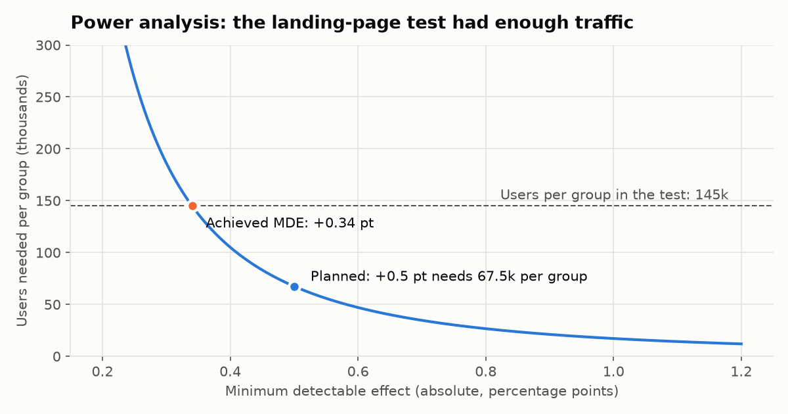
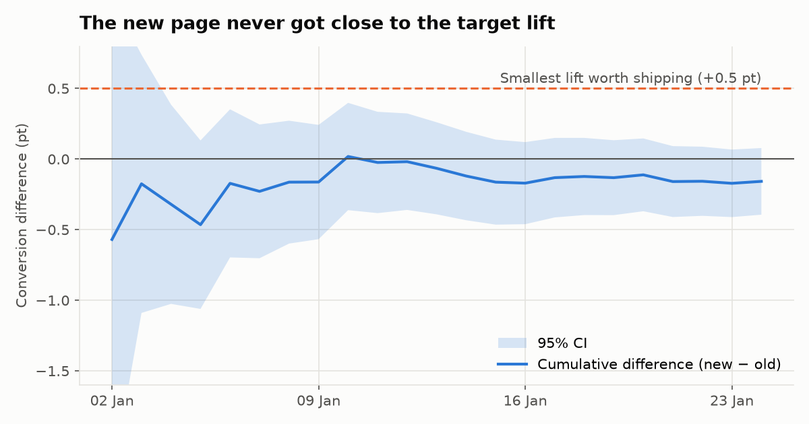
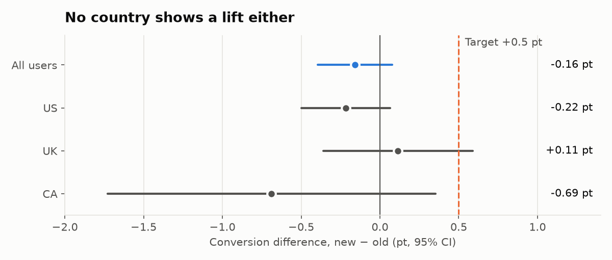
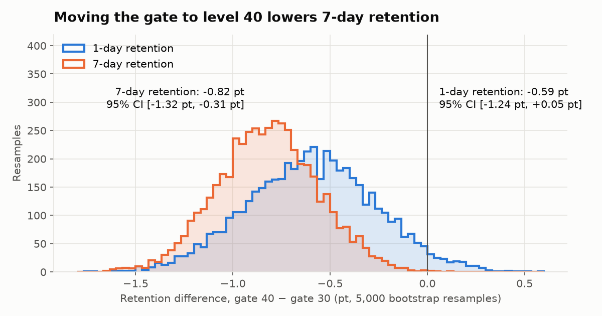

# A/B Testing Case Study: Two Experiments, Two Decisions

**Don't ship the new landing page: it converts 0.16 pt *worse* (95% CI −0.39 to +0.08 pt), and
the test had enough power to detect the +0.5 pt lift it was looking for. Keep the Cookie Cats
gate at level 30: moving it to level 40 cuts 7-day retention by 0.82 pt (−4.3%, p = 0.002).**

Two real experiments, each analysed the way a product or growth analyst would before a launch
review: plan the sample size, check the experiment is healthy, test the primary metric, put an
interval on the effect, and end with a ship / don't-ship call.

| | Experiment 1: landing page | Experiment 2: Cookie Cats |
|---|---|---|
| Change | New landing page vs. old | First progress gate at level 40 vs. 30 |
| Users | 290,584 | 90,189 |
| Primary metric | Conversion | 7-day retention |
| Effect (B − A) | −0.16 pt (95% CI −0.39 to +0.08) | −0.82 pt (95% CI −1.33 to −0.31) |
| p-value | 0.19 | 0.0016 |
| Sanity check | Sample ratio OK (p = 0.95) | **Sample ratio mismatch (p = 0.009)** |
| Decision | **Don't ship** | **Keep gate at 30** |

---

## Problem

- **Experiment 1:** an e-commerce company built a new landing page and ran a 23-day A/B test.
  Should they switch everyone to it?
- **Experiment 2:** the mobile puzzle game *Cookie Cats* makes players wait (or pay) at a "gate".
  The team tested moving the first gate from level 30 to level 40. Does that keep players around
  longer?

## Data

| Dataset | Rows | Source |
|---|---:|---|
| `ab_data.csv` + `countries.csv` | 294,478 exposures, Jan 2017 | Udacity *Analyze A/B Test Results* ([mirror](https://github.com/Hindhuja-Gutha/Analyze-AB-TestResults)) |
| `cookie_cats.csv` | 90,189 players | DataCamp / Kaggle *Mobile Games A/B Testing* ([mirror](https://github.com/robguilarr/ab_testing_cookie_cats)) |

`abtest/data.py` downloads both into `data/` on the first run.

## Approach

1. **Power analysis first.** Before reading the results, decide the smallest effect worth shipping
   and check the test had enough users to detect it.
2. **Sanity checks.** Clean assignment errors, then test for sample-ratio mismatch (SRM): a
   chi-square test that the split between groups matches the planned 50/50.
3. **Primary metric.** Two-proportion z-test, with a 95% confidence interval for the absolute
   difference and the relative lift.
4. **Robustness.** A bootstrap CI, a Bayesian P(B > A) with expected loss, a daily trend check
   for novelty effects, and segments with a Holm correction for multiple testing.
5. **Decision.** Weigh the interval against the minimum effect worth shipping, not just the p-value.

Every formula is written out in [`abtest/stats.py`](abtest/stats.py) and checked against
statsmodels in [`tests/test_stats.py`](tests/test_stats.py) (z-test, Holm), plus a simulation
showing the 95% CI really covers the true difference about 95% of the time.

## Experiment 1: landing page

### Power analysis

At a 12% baseline, a +0.5 pt lift (≈ +4% relative) is the smallest change worth a redesign.
Detecting it with α = 0.05 and 80% power needs **67,496 users per group**. The test got 145k per
group, so it could detect effects down to **+0.34 pt**. A null result here means "no meaningful
lift", not "not enough data".



### Sanity checks

| Step | Rows |
|---|---:|
| Raw exposures | 294,478 |
| Group and page agree (control saw the old page, treatment the new one) | 290,585 |
| One row per user (first exposure kept) | 290,584 |

- 3,893 rows (1.3%) had a user in one group seeing the other group's page. That's an
  assignment bug, and those rows can't be attributed to either arm, so they are dropped.
- **SRM:** 145,274 control vs. 145,310 treatment, p = 0.95. The split is healthy.

### Result

| Group | Users | Conversion |
|---|---:|---:|
| Old page (control) | 145,274 | 12.04% |
| New page (treatment) | 145,310 | 11.88% |
| **Difference** | | **−0.16 pt (−1.3% relative)** |

- z = −1.31, p = 0.19. 95% CI for the difference: **−0.39 to +0.08 pt**. The bootstrap CI agrees
  (−0.39 to +0.09).
- Bayesian view: P(new page is better) = **9.5%**.
- The whole confidence interval sits below the +0.5 pt target, so even the best case isn't worth
  shipping.



The cumulative difference touches zero around day 9, then drifts below it and stays there to the
end of the test. There is no early spike that fades out. So there is no novelty effect hiding a real result.

### Segments

| Country | Users | Old | New | Difference (95% CI) | p | Holm-adjusted p |
|---|---:|---:|---:|---|---:|---:|
| US | 203,619 | 12.06% | 11.85% | −0.22 pt (−0.50, +0.07) | 0.13 | 0.40 |
| UK | 72,466 | 12.00% | 12.12% | +0.11 pt (−0.36, +0.59) | 0.63 | 0.63 |
| CA | 14,499 | 11.88% | 11.19% | −0.69 pt (−1.73, +0.35) | 0.19 | 0.40 |



No country shows a significant effect, before or after correcting for testing three segments.
The UK's +0.11 pt is noise, and it would be a mistake to ship the page to the UK only.

**Decision: don't ship.** Keep the old page and spend the design effort on a bolder change.

## Experiment 2: Cookie Cats

### Sanity check: a sample-ratio mismatch

| Gate | Players | Share |
|---|---:|---:|
| Level 30 (control) | 44,700 | 49.56% |
| Level 40 (treatment) | 45,489 | 50.44% |

- A 50/50 split this uneven happens by chance less than 1% of the time (**p = 0.009**).
- The gap is small (789 players), and retention is still measured per assigned player. But in a real
  team I would **flag it to engineering before trusting the result**: check how players were
  bucketed, and whether some gate-30 players were lost from logging (for example, players who
  churned before an event fired).
- Other checks look healthy: the share of players with 0 rounds is about the same (4.3% vs. 4.5%),
  and so are median rounds (17 vs. 16) and 99th-percentile rounds (493 vs. 492). One gate-30
  player has 49,854 rounds, an outlier that doesn't affect the retention metrics.

### Power

With ~45k players per group, the test can detect a **0.74 pt** change in 7-day retention and a
0.93 pt change in 1-day retention (α = 0.05, 80% power).

### Result

| Metric | Gate 30 | Gate 40 | Difference (95% CI) | Relative | p | P(gate 40 better) |
|---|---:|---:|---|---:|---:|---:|
| 1-day retention | 44.82% | 44.23% | −0.59 pt (−1.24, +0.06) | −1.3% | 0.074 | 3.7% |
| **7-day retention** | **19.02%** | **18.20%** | **−0.82 pt (−1.33, −0.31)** | **−4.3%** | **0.002** | **0.1%** |



- 7-day retention is the metric that matters for long-term revenue, and it drops clearly.
- 1-day retention points the same way but isn't significant on its own.
- A likely explanation: hitting the gate earlier forces a break, and the break makes the game feel fresh
  (hedonic adaptation). Moving the gate later lets players burn out first.

**Decision: keep the gate at level 30,** pending an SRM investigation. Even at the edge of the
interval closest to zero, gate 40 loses 0.31 pt of 7-day retention.

## Recommendations

| # | Decision | Why | Next step |
|---|---|---|---|
| 1 | Keep the old landing page | Point estimate is negative; even the upper CI bound (+0.08 pt) is far below the +0.5 pt target; the test was well powered | Test a bolder change (offer, pricing display, form length) rather than iterating on this design |
| 2 | Fix the assignment bug | 1.3% of exposures saw the other arm's page | Add an assignment-consistency check to the experiment platform |
| 3 | Keep the Cookie Cats gate at level 30 | 7-day retention −0.82 pt, CI excludes zero, P(gate 40 better) = 0.1% | Ship nothing; consider testing gate 20 or shorter wait times |
| 4 | Investigate the Cookie Cats SRM | p = 0.009 on the 50/50 split | Audit bucketing and logging before using this experiment framework again |
| 5 | Make power analysis and SRM checks standard | Both caught real issues here | Add them to the pre-launch and readout templates |

**Caveats:** both datasets are public teaching datasets with no revenue data, so the decisions are
made on conversion and retention, not on money. The Cookie Cats SRM means its result should be
re-confirmed after the bucketing audit.

## How to run

```bash
python -m venv .venv
.venv/Scripts/activate            # Windows; on macOS/Linux: source .venv/bin/activate
pip install -r requirements.txt
python -m abtest.run              # downloads the data, writes reports/results.md and the charts
python -m pytest                  # statistics tests
```

## Structure

```
abtest/
  data.py           download and load both datasets
  stats.py          sample size, MDE, SRM, z-test + CI, bootstrap, Bayesian P(B>A), Holm
  landing_page.py   experiment 1: cleaning, power, test, daily trend, country segments
  cookie_cats.py    experiment 2: SRM, retention tests, bootstrap, engagement checks
  run.py            runs both, writes reports/results.md and reports/figures/
tests/
  test_stats.py     checks against statsmodels, CI coverage simulation
reports/
  results.md        every number in this README, regenerated by run.py
  figures/          charts
```
